# Notas de trabajo – Parte 1: Adquisición en vivo

**Actividad:** Adquirir un equipo comprometido  
**Módulo:** Análisis Forense Informático – UD1  
**Analista:** Gonzalo García Vega  
**Equipo investigado:** FORENSIC_10  
**Sistema operativo:** Windows 7  
**Hipervisor:** UTM  
**Fecha de intervención:** 31/10/2026

---

## 1. Registro del estado inicial

**Hora:** 17:00.

Realicé una captura de pantalla del estado inicial de Windows 7, mostrando la máquina encendida y la marca identificativa preparada.

También registré la hora del sistema investigado y la hora real del equipo anfitrión (macOS), para comprobar si existía algún desfase horario.

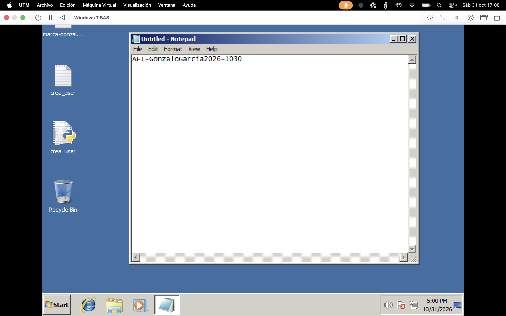

**Resultados:**

- Hora de Windows 7: 17:20.
- Hora de macOS: 17:20.
- Desfase: No hay desfase.

## 2. Adquisición de memoria RAM

**Hora de inicio:** 17:20.  
**Hora de finalización:** 17:32.

Adquirí la memoria RAM con DumpIt, una herramienta destinada a realizar volcados de memoria física.

Elegí esta herramienta para obtener una copia de la memoria mientras el sistema permanecía encendido, preservando información volátil que podría perderse al apagar el equipo.

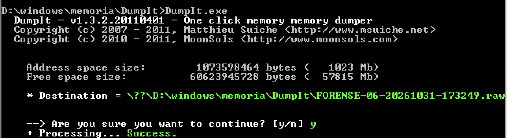

**Procedimiento:**

1. Conecté el medio de respuesta a la máquina virtual mediante UTM.
2. Localicé el ejecutable de DumpIt.
3. Lo ejecuté con los permisos necesarios.
4. Indiqué como destino el medio de respuesta, evitando guardar el volcado en el disco investigado.
5. Esperé a que terminase la adquisición.

**Evidencia obtenida:**

`FORENSE-06-20261031-181741.raw`

**Hashes de la evidencia:**

- **MD5:** `23f01d464fa645b784dce19d994bcc17`
- **SHA-256:** `1cacb65c16cf1acf445cfd209a21485ed46e16f7867be2bac656abc1124ed1c6`

## 3. Adquisición de datos volátiles

**Hora de inicio:** 17:33.  
**Hora de finalización:** 17:35.

Utilicé el script `respuesta-en-vivo.ps1`, proporcionado por el profesor, para recopilar información volátil del sistema.

El objetivo fue obtener información del estado del equipo en el momento de la intervención, complementando el volcado de memoria.

**Procedimiento:**

1. Localicé el script en el medio de respuesta.
2. Lo ejecuté desde Windows PowerShell.
3. Indiqué el destino de salida en el medio de respuesta.
4. Comprobé que la recopilación finalizase correctamente.
5. Conservé los archivos y registros generados.

**Comando utilizado:**

```powershell
.\respuesta-en-vivo.ps1
```

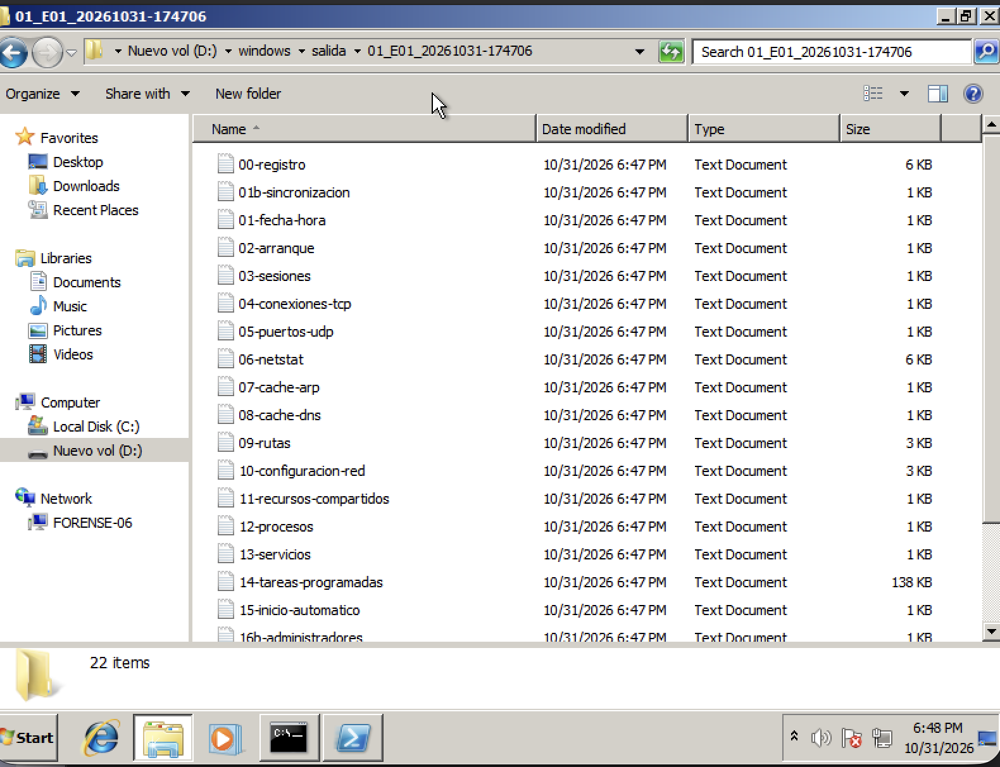

**Incidencias y errores:**

Tuve que corregir este script adaptándolo para poder utilizarlo en Windows 7, ya que originalmente estaba preparado para Windows 10. Después de realizar las modificaciones necesarias, conseguí ejecutarlo correctamente.

## 4. Adquisición del tráfico de red

**Hora de inicio:** 18:50.  
**Hora de finalización:** 18:53.

Capturé el tráfico de red desde el exterior de la máquina virtual, evitando instalar herramientas adicionales en el sistema investigado.

El objetivo fue conservar las comunicaciones de red que se produjeran durante la intervención.

**Entorno utilizado:** UTM sobre macOS.

El procedimiento de referencia del profesor utiliza `VBoxManage`, pero dicho comando pertenece a VirtualBox y no es directamente aplicable a UTM.

Por tanto, lo hice desde la terminal de Mac con los siguientes comandos:

```bash
sudo tcpdump -i vmenet0 -n -s 0 -w ~/Desktop/red.pcap

tcpdump -r ~/Desktop/red.pcap -nn
```

**Evidencia obtenida:**

`red.pcap`

**Hashes de la evidencia:**

- **MD5:** `3c53275bcbbb04a8b26b42857aa1a52c`
- **SHA-256:** `9f8d9947a34c07e9569762c2f86e67ffc20e735dfd3704d3db4dada3c77f8091`

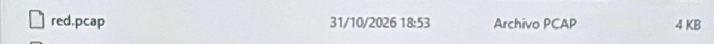

## 5. Adquisición mediante triaje

**Hora de inicio:** 19:45.  
**Hora de finalización:** 19:53.

Realicé una recopilación forense mediante una herramienta de triaje para obtener información relevante del sistema de archivos y de la actividad del equipo investigado.

El objetivo era recopilar información del Registro de Windows y los registros de eventos para poder analizarlos posteriormente e identificar posibles actividades sospechosas.

**Procedimiento:**

1. Ejecuté la herramienta de triaje desde el medio de respuesta.
2. Seleccioné los elementos que quería recopilar del equipo investigado.
3. Indiqué como destino de los resultados el medio de respuesta.
4. Esperé a que finalizara la recopilación.
5. Comprobé los archivos generados y los conservé para su posterior análisis.

**Evidencias obtenidas:**

Durante la recopilación obtuve los siguientes archivos:

- `SAM.hiv`: contiene información sobre las cuentas de usuario locales de Windows.
- `SOFTWARE.hiv`: contiene información sobre el software instalado y la configuración del sistema.
- `SYSTEM.hiv`: contiene información sobre la configuración del sistema.
- `Security.evtx`: registro de eventos relacionados con la seguridad de Windows.
- `System.evtx`: registro de eventos del sistema operativo.

**Hashes de las evidencias:**

| Archivo | MD5 | SHA-256 |
|---|---|---|
| `SAM.hiv` | `80815e7de21b84524d9f25612b65b429` | `e997629a1b359160b7d20f0f3d6341a3190678f1fbf4d0283670ee42b2d870cb` |
| `SOFTWARE.hiv` | `014b622a542a1f335d3d8b89e24450c2` | `a1e544731419566e3a9eeadf9b506ff331d3fcb7581414cc0eccc0cb56f98068` |
| `SYSTEM.hiv` | `ccc36705c23d5be2aeaf3dc9c6c71b67` | `72456665469b8f63032bfe2d7c25cf073285582010181d620286f6759ddd62ce` |
| `Security.evtx` | `6da090984c3142862060e1a29bbc0460` | `3e38f67001e4165a50b329ccc9b5ba7d583c3ea111893439d599dd4316cf822b` |
| `System.evtx` | `74ca0c68d4d95d64728cc17e2c333070` | `f48edb3fd46888b4ba4ef1380b09beca25b14e5e8c6e34eb08f67dbfa8a9f613` |

Durante la recopilación tuve que comprobar los archivos obtenidos para asegurarme de que se habían generado correctamente.

Todos estos archivos se guardaron en el medio de respuesta para poder analizarlos posteriormente.

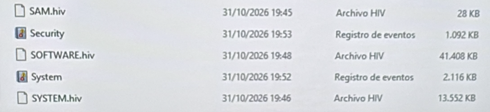

## 6. Comprobación del cifrado

**Hora:** 20:03.

Antes de apagar el equipo comprobé si existían volúmenes cifrados para evitar perder posibles claves de descifrado durante el apagado.

Para ello, ejecuté el siguiente comando desde PowerShell con permisos de administrador:

```cmd
manage-bde -status
```

Este comando permite consultar el estado de cifrado de las unidades mediante BitLocker.

**Resultado obtenido:**

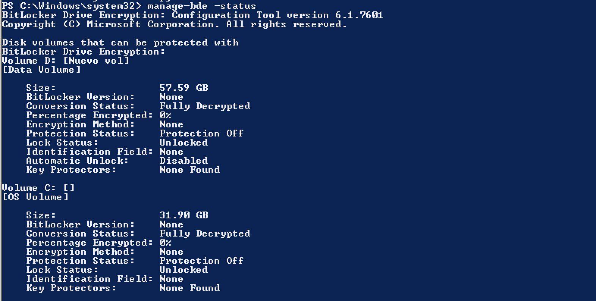

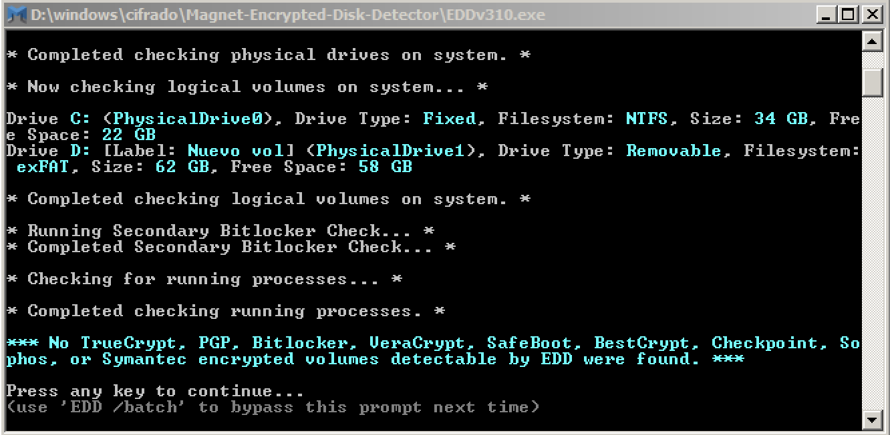

El resultado mostró que las unidades C: y D: estaban completamente descifradas, con un porcentaje de cifrado del 0 %. Además, utilicé Magnet Encrypted Disk Detector (EDD) como segunda comprobación y tampoco detectó ningún volumen cifrado.

Por tanto, comprobé que no era necesario realizar ninguna actuación para conservar claves de descifrado antes de apagar el equipo.

## 7. Apagado del equipo investigado

**Hora:** 20:12.

Una vez finalizadas las adquisiciones en vivo y comprobado el estado del cifrado, apagué el equipo.

**Método de apagado utilizado:**

Apagado forzado de la máquina virtual desde UTM, desconectando su ejecución sin realizar el apagado normal de Windows.

**Justificación:**

Al comprobar que no existen volúmenes cifrados, no existe riesgo de perder claves de descifrado al apagar el equipo. Sin embargo, considero que realizar un apagado limpio podría permitir que se ejecutasen procesos adicionales, incluidos posibles programas maliciosos, y que se modificasen algunas evidencias del sistema.

Por este motivo, una vez finalizada la adquisición de las evidencias volátiles, especialmente la memoria RAM y el tráfico de red, opté por realizar un apagado forzado del equipo.

Esta decisión permite detener la ejecución de posibles procesos maliciosos y evitar que el sistema continúe modificando información.

Se comprobó que la máquina virtual quedó completamente apagada antes de comenzar la adquisición post-mortem.

---

## 8. Resumen de hashes de las principales evidencias

Para conservar la integridad de las evidencias, calculé los hashes MD5 y SHA-256 de los archivos adquiridos.

| Evidencia | MD5 | SHA-256 |
|---|---|---|
| Memoria RAM | `23f01d464fa645b784dce19d994bcc17` | `1cacb65c16cf1acf445cfd209a21485ed46e16f7867be2bac656abc1124ed1c6` |
| Tráfico de red | `3c53275bcbbb04a8b26b42857aa1a52c` | `9f8d9947a34c07e9569762c2f86e67ffc20e735dfd3704d3db4dada3c77f8091` |
| SAM.hiv | `80815e7de21b84524d9f25612b65b429` | `e997629a1b359160b7d20f0f3d6341a3190678f1fbf4d0283670ee42b2d870cb` |
| SOFTWARE.hiv | `014b622a542a1f335d3d8b89e24450c2` | `a1e544731419566e3a9eeadf9b506ff331d3fcb7581414cc0eccc0cb56f98068` |
| SYSTEM.hiv | `ccc36705c23d5be2aeaf3dc9c6c71b67` | `72456665469b8f63032bfe2d7c25cf073285582010181d620286f6759ddd62ce` |
| Security.evtx | `6da090984c3142862060e1a29bbc0460` | `3e38f67001e4165a50b329ccc9b5ba7d583c3ea111893439d599dd4316cf822b` |
| System.evtx | `74ca0c68d4d95d64728cc17e2c333070` | `f48edb3fd46888b4ba4ef1380b09beca25b14e5e8c6e34eb08f67dbfa8a9f613` |

Estos valores permiten comprobar posteriormente que las evidencias no han sufrido modificaciones.

# Notas de trabajo – Parte 2: Adquisición Post-Mortem

## 1. Documenta la máquina

**Máquina virtual:** Windows-7-SAS.

**Hipervisor:** UTM (macOS).

**Estado:** Máquina apagada durante el proceso de adquisición.

**Ubicación de la máquina:**

`/Users/gonzalo/Downloads/Windows-7-SAS.utm/`

**Archivos identificados:**

| Archivo | Descripción |
|---|---|
| `config.plist` | Archivo de configuración de la máquina virtual. |
| `Data/disco.qcow2` | Disco virtual que contiene el sistema y los datos de la máquina. |

**Características del disco:**
- **Formato:** QCOW2.
- **Tamaño del fichero:** 13 GB.
- **Ruta:** `Windows-7-SAS.utm/Data/disco.qcow2`.

**Info:** Al utilizar UTM en macOS, la máquina no dispone de un fichero `.vbox` ni de un disco `.vmdk`. Por tanto, se trabajará con el archivo de configuración `config.plist` y el disco virtual `disco.qcow2`.

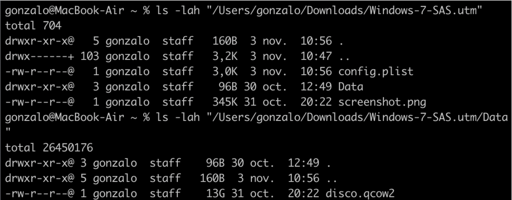

## 2. Calcula el hash de cada fichero de esa carpeta

Se han calculado los hashes SHA-256 de los archivos originales de la máquina virtual mediante la herramienta `shasum` de macOS.

| Archivo | SHA-256 |
|---|---|
| `disco.qcow2` | `ef94f4ace9055788d536d893ecfa9d63bdb9d3b49763bf9a745fceda44e0f457` |
| `config.plist` | `8781133d06163eb9487ec19bb89ddaa6dea56435f0f0c08af6e744c500024ef9` |

Estos valores servirán como referencia para comprobar posteriormente que los archivos originales no han sufrido modificaciones durante el proceso de adquisición.

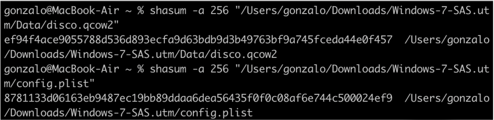

## 3. Haz la imagen del disco y guárdala en tu disco de destino

Para realizar la adquisición post-mortem se ha utilizado la herramienta `qemu-img` en macOS, aprovechando que permite convertir discos virtuales entre diferentes formatos.

El disco original se encontraba en formato QCOW2 (`disco.qcow2`), con un tamaño de fichero de 12,6 GiB y una capacidad virtual de 32 GiB.

Se ha convertido el disco al formato RAW, generando una imagen forense denominada `PC-ADMIN.raw`, que se ha almacenado en un segundo pendrive USB de destino, con formato exFAT.

**Comando utilizado:**

```bash
qemu-img convert -p -f qcow2 -O raw \
"/Users/gonzalo/Downloads/Windows-7-SAS.utm/Data/disco.qcow2" \
"/Volumes/Nuevo vol/salida/practica-afi/PC-ADMIN.raw""
```

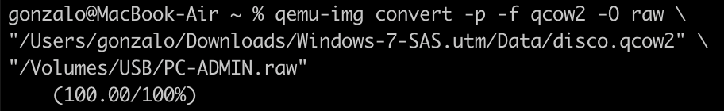

## 4. Vuelve a calcular el hash del disco original

Después de realizar la adquisición, se ha vuelto a calcular el hash SHA-256 del archivo original `disco.qcow2` para comprobar que no ha sufrido modificaciones.

Se ha comparado el resultado con el hash obtenido inicialmente en el apartado 2, comprobando que ambos valores coinciden.

**Resultado:** El hash SHA-256 antes y después de la adquisición es:

`ef94f4ace9055788d536d893ecfa9d63bdb9d3b49763bf9a745fceda44e0f457`

Por tanto, se confirma que el archivo original mantiene su integridad durante el proceso de adquisición.

**Comando utilizado:**

```bash
shasum -a 256 "/Users/gonzalo/Downloads/Windows-7-SAS.utm/Data/disco.qcow2"
```

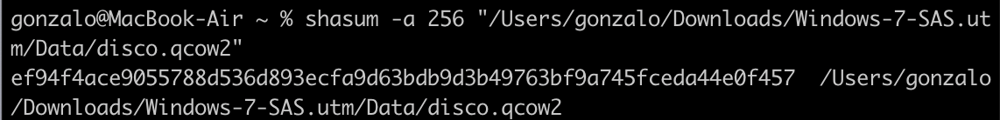

## 5. Copia de la configuración y los registros

Se ha copiado el archivo de configuración `config.plist` de la máquina virtual UTM al pendrive utilizado como destino de la adquisición, junto a la imagen forense `PC-ADMIN.raw`.

Se hizo la copia con este comando:

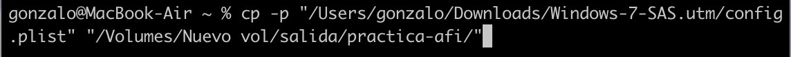

Posteriormente, se han calculado los hashes SHA-256 del archivo original y de su copia para comprobar que ambos son idénticos.

| Archivo | SHA-256 |
|---|---|
| Original `config.plist` | `56bd6f521ec75dfd56352c2f13cbae71fbb1393992d2642ba6fb715ff9b6875d` |
| Copia `USB/config.plist` | `56bd6f521ec75dfd56352c2f13cbae71fbb1393992d2642ba6fb715ff9b6875d` |

Por otro lado el hash del archivo original .qcow2 y el de la imagen obtenida .raw no coinciden, ya que representan formatos y estructuras diferentes. El primero corresponde al fichero que contiene el disco virtual de la máquina Windows 7, mientras que el segundo corresponde a la imagen RAW generada a partir de su contenido.

Para comprobar la integridad, se calcula el SHA-256 del archivo .qcow2 antes:
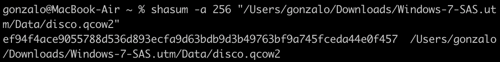

y el este es el SHA-256 del .raw.
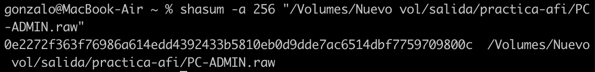

El hash del archivo original .qcow2 y el de la imagen .raw no coinciden, y es lo normal: uno corresponde al fichero que contiene el disco virtual de la máquina Windows 7 y el otro a la imagen RAW obtenida a partir de su contenido.

**Comando utilizado:**

```bash
shasum -a 256 "/Users/gonzalo/Downloads/Windows-7-SAS.utm/config.plist"
shasum -a 256 "/Volumes/USB/config.plist"
```

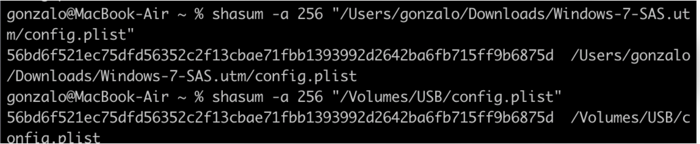

## El pendrive encontrado

Pendrive: TOSHIBA 8GB
Capacidad: 8 GB
Numero de serie: A53D6E8E-84F3-4D8A-8_00000001

Aqui os dejo las fotos del pendrive encontrado:
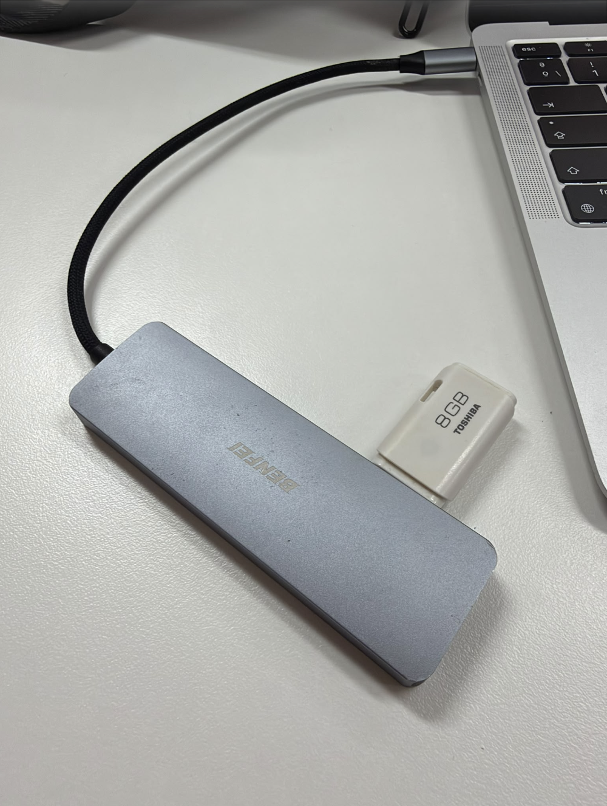
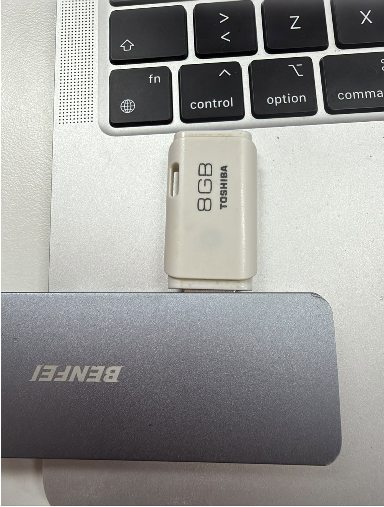

Ahora me descargé en mi máquina windows bloqueo-usb.ps1 y activé el bloqueo antes de conectar el pendrive.

Para ello en powershell tuve que poner los siguientes comandos, el primero el set execution para poder ejecutar scripts ya que por defectos vienen bloqueados en windows y el segundo la ejecución de dicho script.

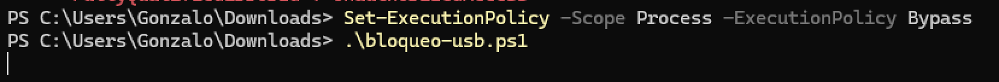

Una vez ejecutado el script en powershell se nos abrió el y como véis Windows permitía escribir en los dispositivos USB porque la política general de protección está desactivada.

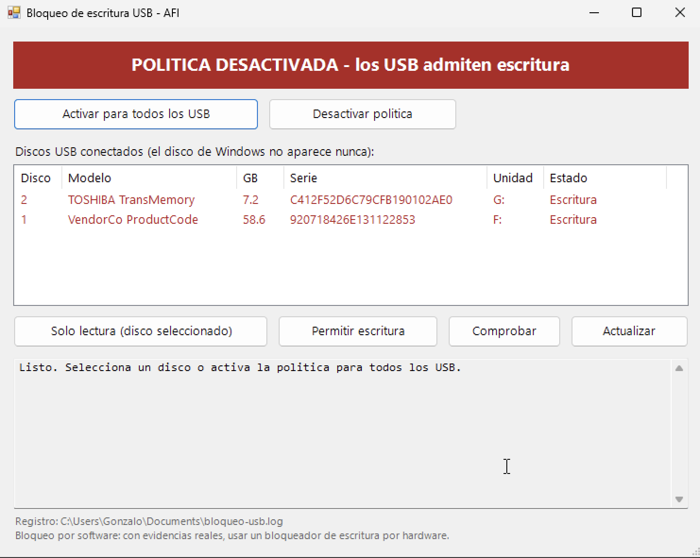

Tras investigar el problema, se comprobó que Windows tenía activada una política de protección contra escritura para dispositivos de almacenamiento USB.

Para solucionarlo, se accedió al Editor del Registro de Windows (`regedit`) y a la siguiente ruta:

`HKEY_LOCAL_MACHINE\SYSTEM\CurrentControlSet\Control\StorageDevicePolicies`

Como el storageDevicePolicies no estaba creado pues pulsamos clic derecho nuevo y lo creamos.

Luego dentro creamos el valor DWORD de 32 bits `WriteProtect`.

| Valor | Comportamiento |
|---|---|
| `1` | Activa la protección contra escritura USB. |
| `0` | Desactiva la protección contra escritura USB. |

Después de realizar este cambio, FTK Imager pudo continuar con la adquisición de la imagen forense.

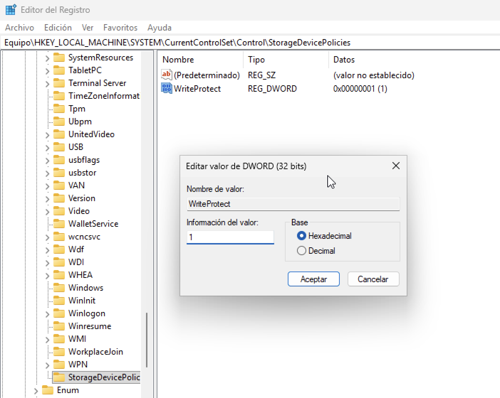

### Activación de la protección contra escritura

Una vez conectado el pendrive original TOSHIBA TransMemory, se ejecutó la herramienta `bloqueo-usb.ps1` para activar la protección contra escritura.

La aplicación mostró el mensaje `POLÍTICA ACTIVADA - USB en solo lectura`. Tras seleccionar el dispositivo y comprobar su estado, se verificó que aparecía como `SOLO LECTURA`.

De esta forma, se protegió el dispositivo original frente a posibles modificaciones durante el proceso de adquisición forense, preservando la integridad de la evidencia.

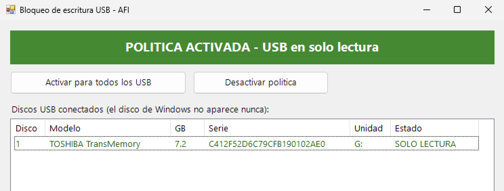

Una vez activada la política procedimos a en FTK Imager, File → Create Disk Image → Physical Drive → el pendrive → E01, con Verify images after they are created.

Aqui vemos el paso a paso en ftk hasta que se completa la imagen E01 del usb encontrado.

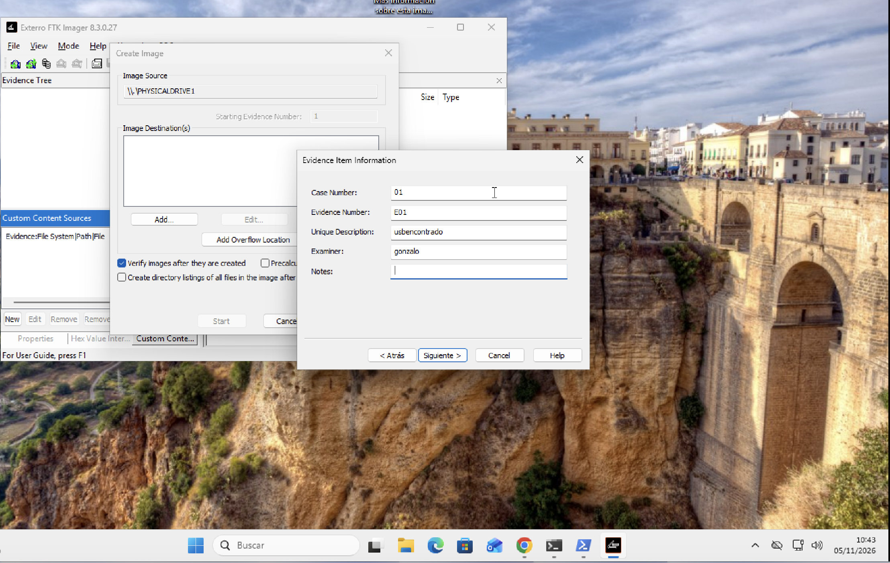
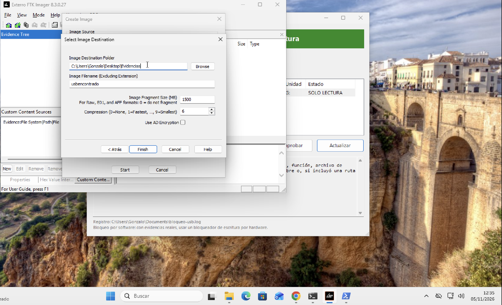
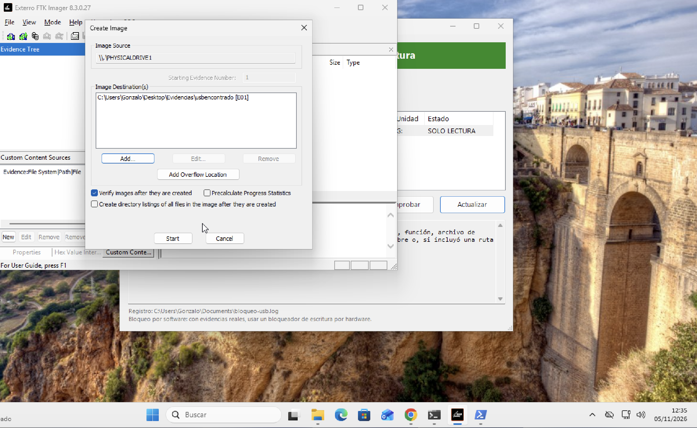
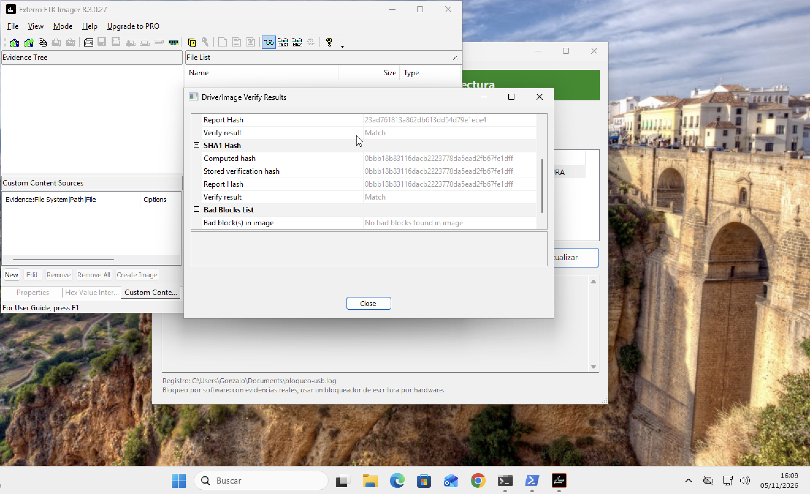

En la captura final podemos observar como se realizó correctamente la imagen.

Por último guardamos bloqueo-usb.log junto a las evidencias.

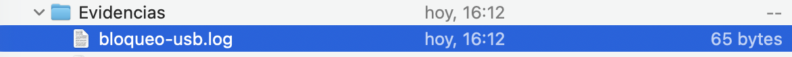

# Notas de trabajo – Parte 3: Busca tu marca

### Búsqueda de la marca en la memoria RAM

Se realizó una búsqueda de la marca personal en el volcado de memoria RAM `FORENSE-06-20261031-181741.raw`, utilizando `strings` para extraer cadenas y `grep` para localizar el identificador personal.

**Comando ejecutado:**

```bash
strings -el FORENSE-06-20261031-181741.raw | grep -i "AFI-"
```

Como podemos observar se encontró la marca de la ram correctamente:

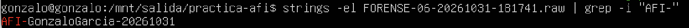

### Preparación y montaje de la imagen del disco

En primer lugar, se identificó la estructura de particiones de la imagen forense `PC-ADMIN.raw` mediante el comando `fdisk`.

**Comando ejecutado:**

```bash
sudo fdisk -l PC-ADMIN.raw
```

A continuación, se creó un directorio para montar la imagen:
```bash
sudo mkdir -p /mnt/pc-admin
```

Se montó la segunda partición de la imagen en modo de solo lectura (ro), utilizando su desplazamiento inicial, calculado a partir del sector de inicio indicado por fdisk (206848):
```bash
sudo mount -o loop,ro,offset=$((206848*512)) PC-ADMIN.raw /mnt/pc-admin
```

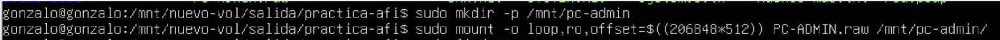

### Localización de la marca en la imagen del disco

Se montó la imagen `PC-ADMIN.raw` en modo de solo lectura y se realizó una búsqueda del fichero personal en el sistema de archivos.

**Comando ejecutado:**

```bash
sudo find /mnt/pc-admin -iname '*AFI*' -o -iname '*GonzaloGarcia*'
```

Como podéis ver se localizó el fichero marca-gonzalogarcia.txt.txt en el escritorio del usuario Administrador.
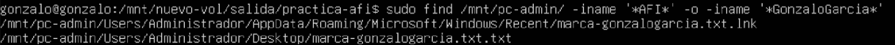

### Acceso al disco externo y localización de la imagen forense

En primer lugar, se identificó el disco externo mediante `lsblk -f`, 
comprobando que correspondía al dispositivo `/dev/sda1`, con formato 
exFAT y etiqueta `Nuevo vol`.

Se creó el directorio de montaje y se montó el volumen en modo de 
solo lectura para evitar modificar su contenido:

```bash
sudo mkdir -p /mnt/nuevo-vol
sudo mount -t exfat -o ro /dev/sda1 /mnt/nuevo-vol
```

Luego se comprobó el contenido del volumen:
```bash
ls -lah /mnt/nuevo-vol/
```

Finalmente, se utilizó find para localizar el archivo principal
de la imagen forense del pendrive:
```bash
find /mnt/nuevo-vol -type f -name "usbencontrado.E01"
```

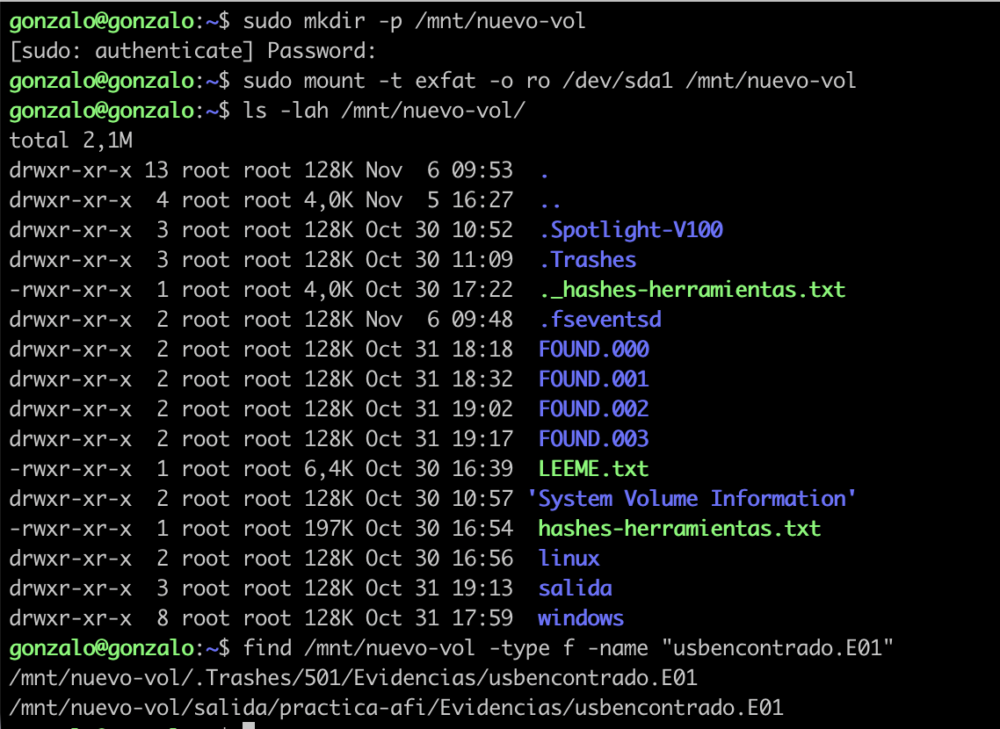

### Localización de la marca en la imagen forense del pendrive

Una vez creada la imagen forense del pendrive en formato E01 mediante FTK Imager, se procedió a analizarla desde CAINE (Linux).

En primer lugar, se creó el directorio `/mnt/ewf` y se utilizó `ewfmount` para acceder al contenido de la imagen forense:

```bash
sudo mkdir -p /mnt/ewf
sudo ewfmount /mnt/nuevo-vol/salida/practica-afi/Evidencias/usbencontrado.E01 /mnt/ewf
```

A continuación, se identificó la estructura de particiones mediante fdisk:

```bash
sudo fdisk -l /mnt/ewf/ewf1
```
Se identificó una partición FAT32 de aproximadamente 7,2 GB, cuyo sector inicial era el 63.

Posteriormente, se creó el directorio /mnt/usb y se montó la partición en modo de solo lectura, utilizando el desplazamiento correspondiente al sector inicial:

```bash
sudo mkdir -p /mnt/usb
sudo mount -o loop,ro,offset=$((63*512)) /mnt/ewf/ewf1 /mnt/usb
```

Una vez montada la partición, se realizó una búsqueda del fichero de marca utilizando el siguiente comando:

```bash
sudo find /mnt/usb -type f -iname '*marca*'
```

Finalmente se vio lo que contenía el fichero con el comando:

```bash
cat "/mnt/usb/marca-gonzalogarcia.txt.txt"
```

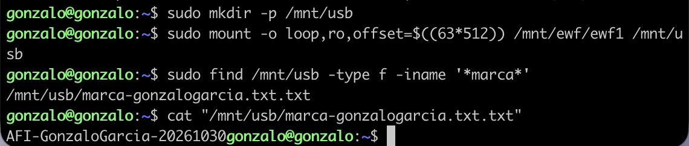

### Búsqueda de la marca en el triaje

Durante esta fase se intento localizar el archivo `$MFT` (*Master File Table*), que contiene los registros de los archivos del sistema de archivos NTFS. Según las indicaciones de la actividad, aunque el triaje no recoge directamente los archivos del escritorio, sí debería incluir esta tabla, donde aparece el nombre del fichero de marca codificado en UTF-16LE.

La búsqueda se hacía con el comando indicado en el enunciado:

```bash
strings -el '$MFT' | grep "marca-"
```

Sin embargo, no fue posible realizar esta comprobación porque no se consiguió obtener el archivo $MFT entre los artefactos recopilados. Esta limitación estuvo relacionada con problemas encontrados al utilizar las herramientas KAPE y Velociraptor en Windows 7, ya que no funcionaron correctamente durante la recopilación de los artefactos.

Ante la imposibilidad de analizar directamente el $MFT, decidií realizar una búsqueda alternativa.

Para ello, se utilizó el siguiente comando, que recorre los archivos del directorio y extrae las cadenas codificadas en UTF-16LE:

```bash
sudo find . -type f -exec sh -c 'strings -el "$1" 2>/dev/null | grep -qi "marca-gonzalogarcia" && echo "$1"' _ {} \;
```

Entre los resultados obtenidos aparecieron varios archivos de la carpeta Prefetch/ReadyBoot. Posteriormente, se comprobó individualmente el contenido de estos archivos mediante el siguiente comando:

```bash
for f in Prefetch/ReadyBoot/Trace*.fx; do
    echo "---- $f ----"
    strings -el "$f" | grep -i "marca-gonzalogarcia"
done
```

Resultados obtenidos:

Se encontraron referencias al nombre del fichero marca-gonzalogarcia.txt.txt en los siguientes archivos:
- Prefetch/ReadyBoot/Trace3.fx
- Prefetch/ReadyBoot/Trace4.fx
- Prefetch/ReadyBoot/Trace5.fx
- Prefetch/ReadyBoot/Trace6.fx
- Prefetch/ReadyBoot/Trace7.fx
En todos ellos apareció la siguiente referencia:Resultados obtenidos:

Se encontraron referencias al nombre del fichero marca-gonzalogarcia.txt.txt en los siguientes archivos:
- Prefetch/ReadyBoot/Trace3.fx
- Prefetch/ReadyBoot/Trace4.fx
- Prefetch/ReadyBoot/Trace5.fx
- Prefetch/ReadyBoot/Trace6.fx
- Prefetch/ReadyBoot/Trace7.fx
En todos ellos apareció la siguiente referencia:

marca-gonzalogarcia.txt

Aunque no fue posible realizar la comprobación específica sobre $MFT debido a que este archivo no estaba disponible entre los artefactos recopilados, se llevó a cabo una búsqueda alternativa en los archivos ReadyBoot disponibles.

Como resultado, se localizaron referencias al nombre del fichero de marca en cinco archivos diferentes (Trace3.fx a Trace7.fx). Por tanto, se obtuvo evidencia adicional de la presencia del nombre del fichero en los artefactos del triaje.

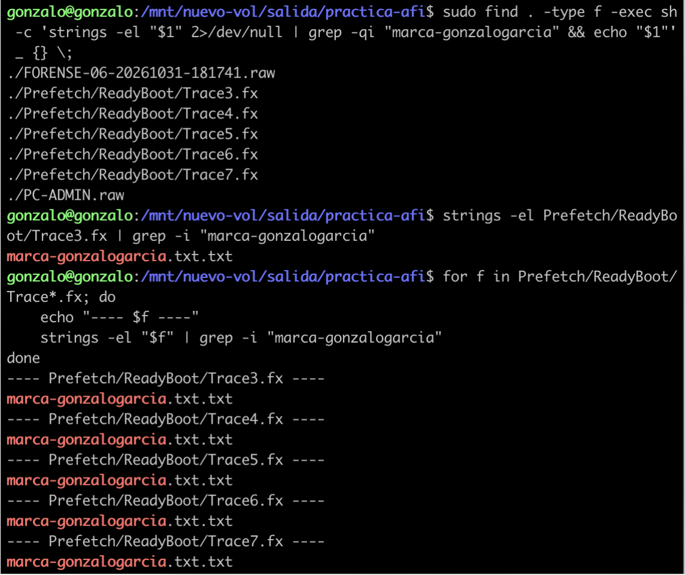


